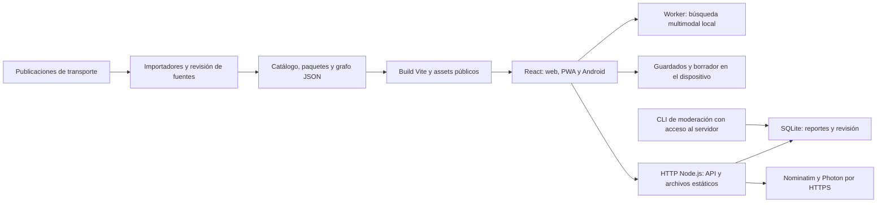

# Especificación técnica de RegioMóvil

**Estado:** piloto funcional, versión de paquete 1.1.0. **Revisión documental:** 29 de octubre de 2026. **Destinatarios:** desarrollo, operaciones, seguridad, datos y responsables de producto.

Este documento describe el código presente en el repositorio. Los comandos se ejecutan desde su raíz. El historial Git identifica la revisión exacta; los inventarios de datos conservan su propia fecha y revisión. Una característica propuesta no debe presentarse como instalada o validada por esta documentación.

## Alcance y límites del producto

RegioMóvil reúne un catálogo de transporte de Nuevo León, mapas, planificación experimental Metro/autobús, guía de viaje, viajes guardados y observaciones comunitarias con texto/foto. La misma interfaz se entrega como web/PWA, Android con Capacitor y modo de pantalla de estación.

| Disponible                                                                                    | Pendiente para una operación pública más amplia                                                    |
| --------------------------------------------------------------------------------------------- | -------------------------------------------------------------------------------------------------- |
| Catálogo y geometrías trazables a fuentes; grafo calculado localmente                         | Validación de secuencia y sentido de autobuses con operadores; completar fuentes faltantes         |
| Simulaciones de llegada, aforo, clima y condición de unidades                                 | Telemetría autorizada, predicciones y métricas con viajes reales                                   |
| Reportes privados por defecto, consentimiento, moderación por CLI y consulta pública filtrada | Administración web autenticada, gestión de casos, indicadores operativos y protocolo institucional |
| Controles de entrada, cabeceras y límites de recursos                                         | Evaluación de seguridad independiente, matriz OWASP verificable y cierre de hallazgos              |
| Endpoint de salud y pruebas automatizadas                                                     | Métricas operativas, Prometheus/Grafana, alertas y ejercicios de recuperación                      |
| Límites de búsqueda, carga diferida y worker                                                  | Perfilado de memoria/renderizado en dispositivos diversos y objetivos de servicio medidos          |

No se gestionan pagos, saldo o boletos. No existe un feed autorizado de GPS de vehículos, reconocimiento visual de daños, autenticación administrativa ni certificación de seguridad. El GPS del dispositivo sirve a la guía de la persona; no informa dónde se encuentran las unidades. La preferencia de accesibilidad devuelve estado desconocido cuando no existe evidencia.

## Arquitectura y fronteras



Los importadores no se ejecutan al abrir una pantalla. El build ordinario prepara artefactos desde archivos ya incorporados al repositorio, sin buscar geometrías en Internet. Las actualizaciones de fuente requieren revisión de identidad del servicio, evidencia y regeneración.

| Componente                                          | Responsabilidad y fuente principal                                                                                                                                                          |
| --------------------------------------------------- | ------------------------------------------------------------------------------------------------------------------------------------------------------------------------------------------- |
| `src/`                                              | Interfaz React 19, TypeScript, identidad visual, mapas y ciclo de navegación.                                                                                                               |
| `src/mobility/worker.ts`, `src/mobility/api.ts`     | Un worker conserva la red y recibe solicitudes efímeras; una petición pendiente reemplaza a la anterior en cola. Tiene salida de error y terminación; sin Worker se importa el motor local. |
| `server/domain.mjs`, `server/model.mjs`             | Funciones portables de simulación y planificación Metro; compartidas entre navegador y API.                                                                                                 |
| `server/mobility.mjs`                               | Motor geográfico multimodal portable, sin acceso a archivos ni red.                                                                                                                         |
| `server/index.mjs`, `server/app.mjs`                | HTTP nativo de Node.js 24, carga de datos, API, cabeceras, cuotas y entrega de `dist/`. No usa Express.                                                                                     |
| `server/storage.mjs`, `server/report-photos.mjs`    | Persistencia SQLite, migraciones, revisión, retención, idempotencia y validación de fotos.                                                                                                  |
| `server/places.mjs`, `server/place-suggestions.mjs` | Consultas externas acotadas; normalización, referencias locales y manejo de errores.                                                                                                        |
| `data/`, `public/route-packs/`, `models/`           | Datos fuente/canónicos, geometrías publicadas y artefacto sintético del modelo.                                                                                                             |
| `scripts/`                                          | Generación de datos, importación, moderación, build Android y preparación de entregables.                                                                                                   |
| `public/sw.js`, `scripts/finalize-web.mjs`          | Caché del shell público; manifiesto y versión de precache derivados del build.                                                                                                              |
| `tests/`, `.github/workflows/checks.yml`            | Verificaciones automáticas y flujo de integración.                                                                                                                                          |

La API usa SQLite síncrono y el cálculo HTTP de rutas también es síncrono: los presupuestos limitan trabajo, pero no convierten el servidor en un sistema apto para alta concurrencia. Debe medirse la saturación antes de elegir réplicas, procesos de cálculo o una base de datos compartida. El navegador usa el worker para reducir trabajo de planificación en el hilo de interacción.

## Entorno, configuración y comandos

Requisitos base: Node.js **≥24**, pnpm **11.25.0** y un sistema de archivos persistente si se conservan reportes. El `pnpm-lock.yaml` fija la resolución de dependencias. Android requiere JDK 21, SDK de Android con plataforma 36 y herramientas de compilación; véase [android.md](android.md).

```bash
pnpm install --frozen-lockfile
pnpm dev
```

Vite escucha en `0.0.0.0:5173` y reenvía `/api` a `127.0.0.1:3001`; el servidor de API escucha por defecto en loopback. La exposición de Vite a la red local es de desarrollo, no una configuración de publicación.

```bash
pnpm build
pnpm start
curl --fail http://127.0.0.1:3001/api/health
```

El build ejecuta TypeScript, prepara catálogo y grafo, construye con Vite y finaliza assets/PWA. `pnpm start` sirve API y `dist/` en un solo proceso. Si `dist/` no existe, la API puede iniciar, pero no estará disponible la interfaz compilada. `./regiomovil build|dev|start|test` ofrece un acceso equivalente que exige Node compatible; puede usar el runtime local de Codex si está presente, sin convertirlo en requisito del proyecto.

| Comando                                                | Uso                                                                                                                |
| ------------------------------------------------------ | ------------------------------------------------------------------------------------------------------------------ |
| `pnpm test`                                            | Suite JavaScript/TypeScript con Node y `tsx`; requiere build previo para pruebas de assets.                        |
| `pnpm test:backend`                                    | Pruebas `backend*.test.mjs`, incluidas seguridad y reportes.                                                       |
| `pnpm catalog:build`                                   | Regenera el catálogo desde fuentes incorporadas.                                                                   |
| `pnpm mobility:build`                                  | Regenera las copias del grafo público y servidor.                                                                  |
| `pnpm model:train`                                     | Reproduce `models/artifact.json` con muestras sintéticas y semilla fija.                                           |
| `python3 -m unittest discover -s tests -p '*_test.py'` | Pruebas de importadores Python; no se incluyen automáticamente en `pnpm test`.                                     |
| `pnpm android:build`                                   | Build y sincronización de assets para APK de depuración; revisar opciones del script antes de una entrega firmada. |
| `./regiomovil android-connect`                         | Comprueba backend local en 4173 y túnel ADB para desarrollo; no instala ni reinicia la app.                        |
| `pnpm release:prepare`                                 | Prepara y verifica artefactos de entrega local; no publica automáticamente.                                        |

### Variables

| Variable                      | Valor o comportamiento predeterminado        | Alcance                                                                                                                                                                       |
| ----------------------------- | -------------------------------------------- | ----------------------------------------------------------------------------------------------------------------------------------------------------------------------------- |
| `HOST`                        | `127.0.0.1`                                  | Interfaz HTTP del servidor. El contenedor utiliza `0.0.0.0`.                                                                                                                  |
| `PORT`                        | `3001`                                       | Puerto HTTP; entero de 0–65535, con 0 reservado a asignación automática útil en pruebas.                                                                                      |
| `DATABASE_PATH`               | `.data/regiomovil.sqlite`                    | Archivo SQLite, fuera de `dist/`. Requiere volumen persistente en despliegues efímeros.                                                                                       |
| `CORS_ORIGINS`                | Lista local explícita                        | Orígenes separados por comas; no se admite `*`. Incluir exactamente los orígenes publicados.                                                                                  |
| `PLACES_PROVIDER_URL`         | `https://nominatim.openstreetmap.org/search` | Destino HTTPS de consulta explícita de lugares.                                                                                                                               |
| `PLACES_SUGGEST_PROVIDER_URL` | `https://photon.komoot.io/api/`              | Destino HTTPS de sugerencias; el proveedor público Nominatim se rechaza para esta función.                                                                                    |
| `PLACES_USER_AGENT`           | Identificador del proyecto                   | Identifica la aplicación ante los proveedores; no contiene credenciales.                                                                                                      |
| `VITE_API_BASE_URL`           | Vacío: mismo origen en web                   | Se incorpora **al compilar** el frontend. Es público y nunca debe contener secretos. Android distribuido requiere backend HTTPS configurado para reportes y búsqueda externa. |

`pnpm start` y `./regiomovil start` cargan `.env` si existe. Los scripts de desarrollo no lo cargan automáticamente: exportar las variables en la terminal. Los valores `VITE_` siguen el mecanismo de entorno de Vite al construir. Usar [.env.example](../.env.example) como plantilla, sin incorporar `.env` o archivos de claves al control de versiones.

El proceso configura `requestTimeout=10000 ms`, `headersTimeout=8000 ms`, `keepAliveTimeout=5000 ms`. En SIGTERM/SIGINT deja de aceptar conexiones, cierra SQLite al finalizar las activas y tiene una salida forzada de 5 s. HTTPS y certificados corresponden al proxy o plataforma de publicación; el servidor local no termina TLS.

### Contenedor

```bash
docker build -t regiomovil .
docker run --rm -p 127.0.0.1:3001:3001 -v regiomovil-data:/data regiomovil
```

`Dockerfile` compila en Node 24 Alpine y ejecuta `dist/`, `server/`, `data/` y `models/` como usuario `node`, sin dependencias npm de servidor. `/data` conserva SQLite. Este ejemplo solo expone loopback; para publicación faltan dominio/TLS, política de red, respaldo/restauración y monitoreo verificados. No ejecutar varias instancias sobre un archivo SQLite compartido por red sin un diseño y pruebas específicos.

## Datos, cobertura y trazabilidad

Fuente de estas cifras: `data/transit-catalog.json`, `data/route-geometry-coverage.json`, `data/route-coverage-inventory.json` y `data/mobility-network.json`, corte **28 de octubre de 2026**, revisión del grafo `cc353bbf5bca`.

| Indicador del artefacto                                   |                            Valor |
| --------------------------------------------------------- | -------------------------------: |
| Servicios del catálogo                                    | 214: 209 de autobús y 5 de Metro |
| Servicios con mapa e incluidos en grafo experimental      | 194: 191 de autobús y L1, L2, L3 |
| Autobuses sin geometría importada                         |                               18 |
| Metro en construcción, fuera del grafo                    |                          L4 y L6 |
| Estaciones únicas de Metro de la red base                 |                               38 |
| Puntos publicados del grafo, con identificadores por ruta |                            10806 |

Los puntos de autobús no equivalen a 10806 infraestructuras físicas distintas: un mismo lugar puede aparecer con identificadores de servicios diferentes. Algunas publicaciones recientes contienen solo dos puntos. La geometría disponible no demuestra un inventario completo de paradas, operación actual o infraestructura construida.

`scripts/prepare-catalog.mjs` combina servicios y evidencia de fuentes. `scripts/prepare-mobility.mjs` produce copias iguales de `data/mobility-network.json` y `public/mobility-network.json` desde la red, catálogo y paquetes locales. Las exclusiones y razones quedan dentro de `coverage`; el inventario diferencia mapa disponible, detalle y participación en el grafo. `planningEligible` del catálogo no sustituye esa evidencia: las geometrías de autobús participan únicamente en el modelo experimental.

Cada actualización debe conservar fuente, fecha de consulta, identidad exacta del ramal, licencia/condiciones de uso y revisión del paquete. No reutilizar un número de ruta para deducir otro ramal. `verifiedAt` es fecha de consulta, no prueba de vigencia. La resolución de fuentes y los 18 pendientes se registran en [auditoria-pendientes-2026-10-28.md](auditoria-pendientes-2026-10-28.md).

## Algoritmos y supuestos

### Construcción del grafo multimodal

1. Metro conserva estaciones consecutivas y continuidad de tren L2–L3 en Zaragoza. Su geometría une coordenadas de estación; no es un levantamiento de vías.
2. Cada marcador de autobús se proyecta al segmento publicado más cercano y se ordena por posición fraccional. Se excluyen marcadores solo propuestos y los que distan más de 160 m del trazo. Los segmentos discontinuos se conservan separados.
3. Se conectan posiciones consecutivas de cada segmento; el motor explora ambos sentidos geométricos. Esto no verifica sentidos comerciales: `stopOrderVerified:false` y `directionVerified:false` documentan la incertidumbre.
4. Una cuadrícula espacial localiza conexiones entre paradas de servicios distintos; conserva hasta 24 enlaces cercanos por parada con diversidad. El conector permite hasta 350 m de caminata estimada. Accesos y salidas examinan hasta 32 candidatos diversos.
5. La caminata se aproxima con distancia geodésica ×1.25 y línea recta. No incorpora banquetas, cruces, entradas o barreras. No se encadenan dos pasos peatonales consecutivos para extender artificialmente el alcance.

### Búsqueda multimodal

`server/mobility.mjs` usa A* con montículo mínimo y costes optimistas desde el grafo inverso. El estado conserva parada, servicio anterior, caminata, modos y transbordos; una frontera de Pareto retiene llegadas que equilibran coste y distancia a pie. El runtime se reutiliza en una `WeakMap` asociada a la referencia de la red.

Se buscan primero opciones de la red completa, Metro, autobús y combinación; después se prueban servicios cercanos al destino, exclusiones y penalizaciones de diversificación. Se deduplican secuencias de servicios y se rechazan ciclos. Se mantienen costes originales para ordenar las opciones, sin añadir las penalizaciones exploratorias a la puntuación publicada.

Límites actuales: **24000 expansiones totales**, hasta 16 sondeos, hasta 6000 expansiones por sondeo general o 3000 de Metro, **8 alternativas**, **4 transbordos** y **1200 m de caminata total**. El resultado no es una enumeración exhaustiva de los ocho caminos óptimos. Diagnósticos distinguen presupuesto agotado, falta de paradas cercanas y red desconectada.

Las velocidades supuestas son 32 km/h para Metro y 18 km/h para autobús, con detenciones, espera y factores de escenario. La preferencia cómoda penaliza aforo sintético; la accesible penaliza más cambios/caminata, sin probar accesibilidad. El intervalo del plan multimodal es ilustrativo y no hereda validación del modelo ridge.

### Simulación y planificador Metro

`server/domain.mjs` construye conexiones consecutivas de las líneas elegibles y busca hasta tres caminos simples mediante una cola ordenada por coste, con techo de 15000 expansiones. No utiliza como conexiones los servicios en construcción o anunciados. Calcula tiempo, espera, ocupación y cambios con supuestos explícitos. La continuidad documentada permite permanecer en el mismo tren.

El panel de llegadas usa `models/artifact.json` y generación seudoaleatoria determinista por estación, escenario y bloque de cinco minutos. Produce llegadas, intervalos, afluencia y condiciones de demostración; no consume observaciones operativas.

### Modelo predictivo sintético

`server/model.mjs` ajusta dos regresiones ridge, una para ETA y otra para ocupación, con λ=2, variables estandarizadas e intercepto sin regularizar. Resuelve el sistema lineal mediante eliminación con pivoteo. La semilla 5012026 genera 2400 muestras: 1680 de entrenamiento, 360 de calibración y 360 de evaluación, separadas antes del ajuste. Las variables incluyen tramos pendientes, hora cíclica, escenario, centralidad, intervalo e interacciones.

El radio nominal del intervalo de 80% se obtiene de residuales absolutos de calibración; evaluación compara con la media del entrenamiento. La ficha reproducible está en `GET /api/model` y [models/README.md](../models/README.md). **Métricas de este generador no demuestran precisión sobre transporte real.** Para un uso predictivo operativo se requieren datos autorizados, observaciones independientes y validación temporal.

## Persistencia, privacidad y ciclo de reportes

El servidor usa `node:sqlite` (`DatabaseSync`), esquema `PRAGMA user_version=3`. Las migraciones se ejecutan transaccionalmente al abrir la base; una versión superior provoca rechazo para evitar abrirla con código antiguo. Datos persistidos:

| Entidad                    | Contenido y control                                                                                                                                                                                                                      |
| -------------------------- | ---------------------------------------------------------------------------------------------------------------------------------------------------------------------------------------------------------------------------------------- |
| `reports`                  | Destino de estación/unidad/ruta, título, categoría, texto, referencias, foto sanitizada, consentimiento, fechas, estado, clave opcional de borrador y hash para idempotencia. Índices de destino/estado/fecha y clave de borrador única. |
| `report_moderation_events` | Acción, reporte, identidad declarada del revisor, nota y fecha. Borrado en cascada al expirar el reporte. No es un registro inmutable ni prueba de identidad.                                                                            |
| JSON de catálogo/modelo    | Archivos de referencia leídos al iniciar; su modificación requiere revisión y regeneración, no un formulario público.                                                                                                                    |

SQLite opera en WAL, `synchronous=NORMAL`, `busy_timeout=3000`, claves foráneas activas y `secure_delete=ON`; configura `journal_size_limit=8388608` para el archivo retenido tras reset/checkpoint y aplica permisos privados al archivo y auxiliares presentes. Ese ajuste no es un techo de disco ni impide que el WAL crezca durante actividad; véase [SQLite PRAGMA](https://www.sqlite.org/pragma.html#pragma_journal_size_limit). Son controles locales: no proporcionan cifrado de disco, de respaldos ni una garantía de eliminación forense. WAL exige respaldos consistentes; no copiar solo el archivo principal mientras la aplicación escribe.

Todo reporte entra `pending` y privado. Consentimiento y revisión explícita permiten `published`; puede pasar a `resolved`, `rejected` o retirarse a `pending` según transiciones permitidas. Solo `published|resolved`, con consentimiento y vigencia, aparece en lectura pública. El estado resuelto refleja una decisión administrativa; debe acompañarse de evidencia de cierre cuando se implemente gestión de casos.

La retención de 90 días elimina reportes al acceder al almacenamiento; no hay limpieza programada. Hay un techo de 5000 reportes y 50 MB decimales de fotografías; al agotarse, se rechazan nuevos envíos. Los originales aceptados en cliente tienen límite de 8 MB y 24 megapíxeles; se reducen a 1280 px por lado mayor y hasta 400000 bytes. El servidor vuelve a validar estructura, tamaño y dimensiones y retira metadatos de los formatos admitidos. No existe anonimización automática de rostros/placas: la revisión humana debe considerarlos antes de publicar.

```bash
node scripts/moderate-report.mjs .data/regiomovil.sqlite list --status pending
node scripts/moderate-report.mjs .data/regiomovil.sqlite show ID_DEL_REPORTE
node scripts/moderate-report.mjs .data/regiomovil.sqlite summary --status public
```

Las acciones de publicación y revisión requieren acceso privilegiado al servidor y sus archivos, fuera de HTTP. El CLI registra el nombre declarado por el operador, sin autenticación propia; los permisos y auditoría del acceso al servidor siguen siendo responsabilidad operativa. Contrato y comandos de revisión: [api.md](api.md) y [quejas-comunitarias.md](quejas-comunitarias.md).

## PWA, Android y recuperación local

El service worker almacena shell y assets públicos del mismo origen; excluye `/api` y reportes. El grafo multimodal se obtiene bajo demanda y queda fuera del precache inicial. La disponibilidad sin red depende de haber descargado los datos requeridos o guardado un paquete de viaje; abrir la app una vez no garantiza que todo mapa o servicio esté disponible offline.

El modo sin conexión del cálculo acepta extremos de paradas oficiales del artefacto, no una búsqueda externa ni nuevas coordenadas. Los viajes guardados incluyen un subconjunto del grafo, geometrías y fuentes: hasta ocho paquetes y 4000000 bytes totales en almacenamiento local. Guardarlos puede conservar lugares o coordenadas elegidos expresamente; no se afirma ausencia total de datos de ubicación en el dispositivo.

El formulario conserva un borrador en IndexedDB y un marcador de apertura en almacenamiento local, con vigencia de 24 h; la foto procesada se conserva según la elección de la persona. La guía guarda un punto de recuperación limitado para volver del reporte, también por 24 h, sin historial de fixes GPS. Son mecanismos de recuperación, no sincronización de reportes offline: enviar requiere API y el acuse puede reintentarse con una clave estable. El almacenamiento del navegador puede fallar o ser eliminado por el dispositivo.

Capacitor empaqueta `dist/` dentro de Android (`mx.regiomovil.app`) sin `server.url`; el inicio no depende de un servidor remoto. `VITE_API_BASE_URL` se fija al construir y se permite backend HTTPS en la versión distribuible. No se deben confundir un APK con acceso local por túnel ADB y uno distribuible que use servidor público. La ubicación funciona en primer plano, se pausa al pasar a segundo plano y se reanuda explícitamente; no hay seguimiento de vehículos ni historial de recorrido por servidor.

## Seguridad y disponibilidad actuales

El servidor limita cuerpos y frecuencia, valida destinos/campos, usa SQL parametrizado y no ofrece endpoints administrativos públicos. Sirve únicamente extensiones permitidas bajo `dist/`, verifica paths reales/symlinks y no expone `.data` o source maps. Usa `nosniff`, protección contra framing, política de referer, CSP y CORS explícito. La CSP permite estilos inline necesarios para posicionar mapas; sus destinos de API/imagen deben revisarse al cambiar la publicación. La validación de fotografías y los tests existentes reducen riesgos conocidos, sin equivaler a una auditoría completa.

El endpoint de salud confirma que el proceso responde. No hay `/metrics`, dashboards de Grafana, alertas ni SLO verificado. Tampoco existen autorización por roles, sesiones administrativas o defensa contra abuso distribuido. La aceptación pública debe exigir evaluación de seguridad con requisitos trazables, pruebas de recuperación y capacidad, y una política de tratamiento de datos. El plan de evaluación, respaldo y observabilidad está en [seguridad y operación](seguridad-y-operacion.md); los criterios de entrega se mantienen en la [hoja de ruta](hoja-de-ruta.md).

## Rendimiento y comprobación

Las capas de memoria acotan recursos: grafo conservado por worker, runtime ligado a su referencia, búsquedas con presupuesto, cola de cálculo limitada, cachés de geocodificación con TTL/cupo y hasta 64 representaciones comprimidas o 8 MiB de caché LRU de archivos del servidor. El servidor comprime texto de 1 KiB–4 MiB, con excepción de hasta 12 MiB para `mobility-network.json`; fuentes e imágenes ya comprimidas se entregan sin esa transformación.

`tests/performance.test.mjs` limita la suma de recursos iniciales a menos de 600 KiB sin comprimir, cada JS a menos de 110 KiB gzip y cada CSS a menos de 16 KiB gzip. `tests/mobility.test.mjs` controla el grafo comprimido y consultas reproducibles. Son presupuestos de regresión, no mediciones de memoria pico, experiencia visual o capacidad de producción. El perfilado pendiente debe medir carga inicial, renderizado/zoom, interacción, pausas del recolector, memoria retenida y cierre/reapertura de flujos en Android de recursos limitados.

La suite cubre API, validación, persistencia, moderación/fotos, cálculo y cobertura, privacidad de lugares, worker, offline, accesibilidad visual, navegación, recuperación y configuración Android. La integración continua instala con lockfile, construye y ejecuta `pnpm test`. Los resultados de una ejecución deben registrarse con comando, revisión, entorno y fecha; no se deben presentar recuentos históricos como evidencia de una ejecución nueva.

Para la revisión del equipo, comenzar por [la guía de revisión técnica](revision-tecnica.md), [api.md](api.md), `.env.example`, `server/app.mjs`, `server/storage.mjs`, `server/mobility.mjs`, inventarios de datos y pruebas asociadas. Los documentos fechados preservan decisiones anteriores; ante cifras históricas distintas prevalecen el inventario y código de la revisión examinada. Las condiciones de distribución y atribución se describen en [licencias y datos](licencias-y-datos.md).
